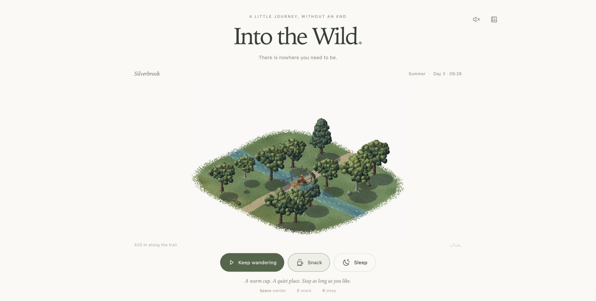

# Into the Wild

**A little journey, without an end.**

[Play in your browser](https://jedix420.github.io/intothewild/)

Walk a winding trail through woods, streams, meadows, mountain passes and enchanted groves. Meet the wildlife, pause for a warm drink, or unroll your bed and wake in another morning. There is nowhere you need to be.



## Play

| Control | Action |
| --- | --- |
| Walk button / Space / Up arrow | Walk forward or pause |
| Snack / E | Sit and have a snack; press again to stand |
| Sleep / R | Rest until the next morning; press again to wake early |
| Speaker / M | Enable or mute the original forest soundscape |
| Notebook / J | Read field notes and controls |

The on-screen controls also work with touch. A day lasts about five minutes; seasons change every two game days. Sleeping advances the clock, so you can experience later seasons without waiting. Quiet wildlife and rare magical inhabitants appear along the trail. Your place and sightings save automatically in this browser. If storage is unavailable, the game still runs for the current session.

All scenery and sound are generated locally. No login, tracking, remote AI calls or runtime packages. The initial journey uses a stable seed; an optional `?seed=12345` starts a different seeded route.

## Run locally

Requires a current Node.js installation. No package installation or build step.

```sh
npm start
```

Open `http://localhost:5300`. Any static file server also works.

```sh
npm run check
npm test
```

## How it works

- The software renderer draws a 480 × 340 pixel canvas with a fixed orthographic camera, depth testing, stepped colour ramps and dithering.
- A small, seeded window of five trail sections is streamed around the traveller. Old sections are discarded; tree sprites have a bounded cache.
- Terrain, wildlife and scenery are deterministic. The journey save stores a seed, distance, clock and limited encounter history, rather than the whole world.
- Walking, sitting and sleeping use articulated procedural animation. Daylight, weather and seasons affect the landscape. The audio is generated with the Web Audio API after a user gesture.
- The app pauses simulation when hidden and resumes without a large elapsed-time jump. Reduced-motion preferences suppress foliage sway and falling particles.

## GitHub Pages

This is a static site with relative asset paths. Publish `main` from `/ (root)` in **Settings → Pages → Deploy from a branch**. `.nojekyll` keeps the files unchanged. The site does not need a custom build workflow.

## Credits

The pixel-rendering foundation is adapted from [Pixel Plays](https://github.com/amirmushichge/pixel-plays) by Amir Mushich, under the MIT licence. Its fixed perspective, small realism and thoughtful shading inspired this game. Original upstream music is not included. The wilderness, journey systems, characters, animals, UI and procedural soundscape are created for Into the Wild.

See [THIRD_PARTY_NOTICES.md](THIRD_PARTY_NOTICES.md) for the upstream licence.
