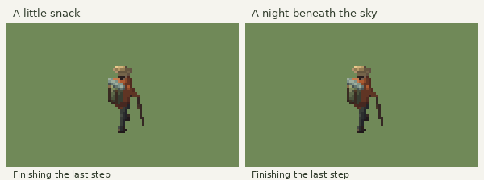
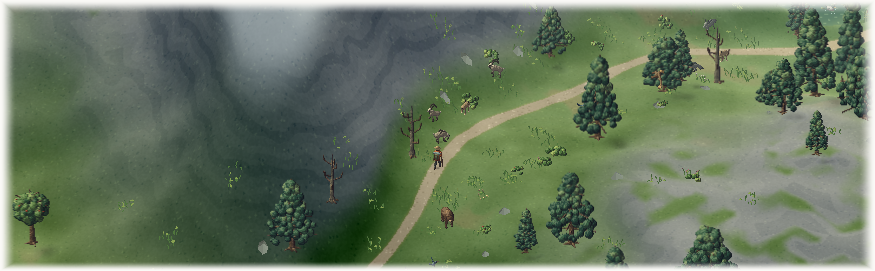
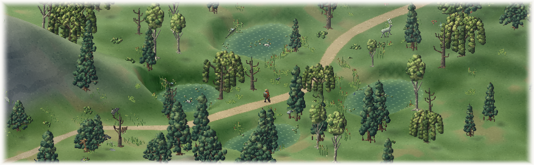

# Into the Wild

**A little journey, without an end.**

[Play in your browser](https://jedix420.github.io/intothewild/)

Walk a winding trail through mixed woodland, lively streams, open meadows, mountain passes, willow wetlands and enchanted groves. Meet the inhabitants, pause for a warm drink, or unroll your bed and wake in another morning. There is nowhere you need to be.


## Play

| Control | Action |
| --- | --- |
| Walk / Space / Up arrow | Walk forward or pause |
| Touch or click an animal or neighbour | Discover its reaction; give it a moment before trying again |
| Tab, then Enter | Interact with nearby wildlife or residents using the keyboard |
| Snack / E | Sit and have a snack; press again to stand |
| Sleep / R | Rest until the next morning; press again to wake early |
| Speaker / M | Listen or mute |
| Notebook / J | Field notes, music selection and credits |

The panorama fills the available screen while the traveller keeps a small, detailed scale. The path climbs, turns beneath ridges and descends through valleys. A day lasts about five minutes; seasons change every two game days. Sleeping advances the clock. Your place and discoveries save automatically in this browser. A shared `?seed=12345` trail has its own save and leaves your main journey intact.

## Taking a break

A snack begins with a **4.4-second sequence**: finish the step, stretch, slip off the backpack, sit, open the pack and bring out bread and a cup. The traveller keeps taking little bites and sips while you watch the forest.

Sleep has its own **4.8-second preparation**: set the pack down, sit, unroll the sleeping bag, take off the hat and curl into bed. Only then does the night pass. Waking includes sitting up, rolling and packing the bed, putting the backpack on and standing again.

Walking resumes after packing up: **2.4 seconds after a snack**, or **3 seconds after sleeping**. You can change your mind during either sequence; the traveller recovers from the current pose and follows your latest choice. Pausing for field notes or hiding the tab pauses the animation, and saved journeys resume the same phase.



## A living wilderness

### The little homes along the way

Occasionally, a clearing reveals a **timber cabin, thatched cottage, round-doored hobbit burrow, stone hillside home, stilt hut, or woodland treehouse**. These places are deliberately uncommon, with long stretches of uninhabited countryside between them. They sit naturally against the terrain, with moss, timber, windows glowing after dark, little gardens, stepping stones, firewood, lanterns and chimney smoke. Snow catches on roofs in winter.

One or two tiny neighbours live near each home. Depending on the place, they might tend a fire, play a lute, chop firewood, water flowers, brew tea, fish, read, light lanterns or look at the sky. Their hands and tools move while you walk, snack or rest. Tap or click a neighbour and they may pause to wave—or carry on with their task—with a short observation in the bottom commentary. They are quiet encounters, not quest-givers, and do not interrupt the forward-only journey. They can also be reached through labelled keyboard controls.

There are **25 inhabitants**: foxes, deer, rabbits, robins, squirrels, badgers, boars, wolves, bears, lynx, wild horses, mountain ibex, owls, eagles, otters, ducks, herons, crocodiles, frogs, trout, butterflies, dragonflies, moonlit stags, lantern spirits and forest unicorns. Encounters are spread along the trail with long quiet stretches between them. Larger mammals are less common, horses occasionally appear in small family groups, trout sometimes jump from the streams, and a wetland may have a single basking crocodile. Pools and riverbanks are often unoccupied.

A forest unicorn, moonlit stag or lantern spirit is a rare surprise. These solitary magical visitors replace an ordinary encounter and are spaced well apart; they are never guaranteed in the opening. Unicorns have a pale coat, a softly lit horn and a few intermittent glints, with gentle reactions when approached.

Touches draw from **110 species-specific responses**, with different movement and poses: approaching, startling, bounding away, rearing, grazing, listening, opening jaws, diving, splashing and more. Reactions begin at the animal’s current position and blend back into its usual activity. Animals keep moving while you pause or take a snack. The field notes remember the species you discover.

**Twelve tree silhouettes** mix with grass, ferns, flowering patches, shrubs, reeds, lilies, mushrooms and fallen logs. Foliage moves in coherent wind while trunks stay rooted. Rolling ground, exposed ridge faces, soil and moss patches, terrain-following shadows and shallow water basins give each habitat a different character. Streams have moving currents, foam, ripples and aquatic life.





## Soundtrack

Four recorded tracks follow the landscape, with gentle crossfades and quiet nature ambience. There are no footstep effects. Music starts after a gesture; the speaker remembers your mute preference. Open Field notes to choose another song.

- **Forest** — syncopika — CC BY 3.0.
- **A Warm Fireplace** — MouthlessGames — CC BY 3.0.
- **It’s Getting Freezing Cold** — MouthlessGames — CC BY 3.0.
- **Vaporware** — The Cynic Project — CC0 1.0.

The recordings are bundled with the game; no external music service is needed. See [full track credits, original sources and licences](docs/music-sources.md). Downloaded music totals about 5.6 MB; the game loads tracks as needed and keeps at most two decoded recordings.

## Run locally

Requires a current Node.js installation. No package installation or build step.

```sh
npm start
```

Open `http://localhost:5300`. Any static file server also works.

```sh
npm run check
npm test
```

## How it works

The dependency-free JavaScript renderer combines a projected heightfield, depth testing, small procedural models and cached tree sprites. World-space vegetation and softly filtered sprite translation avoid independent tree snapping as the camera moves. Terrain caches and streamed scenery keep the visible world bounded rather than accumulating an entire endless map.

The generator retains five to eleven nearby trail chunks. Saves contain only the seed, distance, clock and a limited field guide. Wildlife has deterministic patrols and a bounded runtime reaction director. Aquatic patrols respect stream banks, bridge clearance and wetland pool boundaries. The traveller and land animals use the actual terrain height for their feet.

Simulation stops in a hidden tab, and audio suspends while preserving its position. Reduced-motion preferences suppress foliage sway and decorative falling particles. Canvas wildlife also has labelled keyboard-accessible interaction controls.

## GitHub Pages

This is a static site with relative asset paths. Publish `main` from `/ (root)` in **Settings → Pages → Deploy from a branch**. `.nojekyll` keeps the files unchanged. No build workflow is required.

## Credits

The pixel-rendering foundation is adapted from [Pixel Plays](https://github.com/amirmushichge/pixel-plays) by Amir Mushich under the MIT licence. Its fixed perspective and small, detailed figures inspired this game. Upstream music is not included. The wilderness, journey systems, procedural characters, vegetation, wildlife interactions and interface are created for Into the Wild.

## Licence

The game’s source code is available under the [MIT License](LICENSE). Keep the copyright and licence notices when redistributing it.

The [third-party notices](THIRD_PARTY_NOTICES.md) include the original Pixel Plays MIT licence and copyright notice. The bundled soundtrack is available under each track’s own Creative Commons licence. See the [music credits](docs/music-sources.md) for details.
